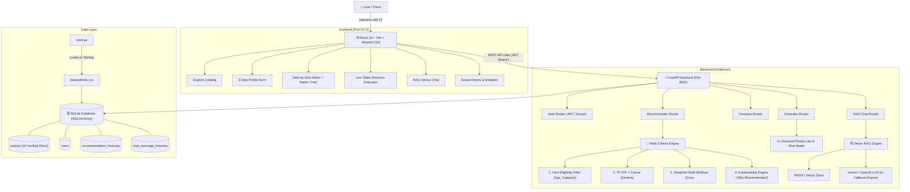

# PolicyPilot AI – Intelligent Insurance Policy Recommendation Platform

PolicyPilot AI is a fintech web platform that evaluates an applicant's profile, health risks, and financial needs to deliver **ranked, explainable insurance policy recommendations** across Health, Term Life, Guaranteed Savings, Motor Auto, and Overseas Travel insurance. It features side-by-side policy comparisons, a 5-axis interactive radar chart, an actuarial live-slider premium estimator, and a Retrieval-Augmented Generation (RAG) AI Advisor.

---

## 🏛️ System Architecture



---

## 🚀 Quick Setup & Run Instructions

### Prerequisites
- Python 3.10 or 3.11
- Node.js v18+ and npm

### 1. Backend Setup
```bash
# In the project root directory
pip install -r requirements.txt

# Start the FastAPI backend
cd backend
python -m uvicorn app.main:app --reload --port 8000
```
- The backend will automatically create `backend/policypilot.db` and seed **44 realistic policies** from `data/policies.csv`.
- Interactive Swagger API docs are accessible at: [http://127.0.0.1:8000/docs](http://127.0.0.1:8000/docs).

### 2. Frontend Setup
```bash
# In a new terminal window, navigate to frontend
cd frontend
npm install
npm run dev
```
- Open [http://127.0.0.1:5173](http://127.0.0.1:5173) in your browser.

### 3. Run Backend Test Suite
```bash
# Run the 10 automated unit & integration tests
$env:PYTHONPATH="backend"; python -m pytest backend/tests -v
```

---

## 🧮 Recommendation Algorithm (Viva Presentation Guide)

When presenting PolicyPilot AI in your viva, summarize the recommendation engine as a **hybrid content-based filtering pipeline** with **hard constraint elimination** and **dynamic multi-attribute utility theory (MAUT)**:

### 1. Hard Eligibility Elimination
- **Category Filter**: Isolates policies matching requested vertical: $C_{\text{policy}} = C_{\text{target}}$.
- **Age Bounds**: Eliminates policies where $\text{Age}_{\text{user}} < \text{Age}_{\text{min}}$ or $\text{Age}_{\text{user}} > \text{Age}_{\text{max}}$.
- **Affordability Ceiling**: Filters out plans where baseline premiums are inaccessible for the user's declared annual budget.

### 2. Multi-Criteria Scoring Formula
For each eligible candidate policy $p$, the total score is computed as:

$$\text{Score}(p) = w_{\text{cov}} S_{\text{cov}} + w_{\text{aff}} S_{\text{aff}} + w_{\text{csr}} S_{\text{csr}} + w_{\text{rat}} S_{\text{rat}} + w_{\text{wait}} S_{\text{wait}} + w_{\text{sim}} S_{\text{sim}}$$

Where:
1. **$S_{\text{cov}}$ (Coverage & Priority Match, 0–100)**: Evaluates alignment between policy inclusions (e.g., maternity, newborn care, AYUSH, critical illness lump-sum, consumables zero-deduction) and user-declared priorities.
2. **$S_{\text{aff}}$ (Affordability Score, 0–100)**: Compares the actuarially estimated personalized premium ($P_{\text{est}}$) against user budget ($B$):
   $$\text{If } P_{\text{est}} \le B: \quad S_{\text{aff}} = 100 - \left(\frac{P_{\text{est}}}{B} \times 20\right)$$
   $$\text{If } P_{\text{est}} > B: \quad S_{\text{aff}} = \max\left(10, 80 - \frac{P_{\text{est}} - B}{B} \times 100\right)$$
3. **$S_{\text{csr}}$ (Claim Settlement Ratio, 0–100)**: Normalized IRDAI track record metric:
   $$S_{\text{csr}} = \min(100, \max(0, (\text{CSR} - 80) \times 5))$$
4. **$S_{\text{rat}}$ (Customer Rating, 0–100)**: Normalized from verified 5-star ratings: $(\text{Rating} / 5.0) \times 100$.
5. **$S_{\text{wait}}$ (Waiting Period Fitness, 0–100)**: Pre-existing condition waiting period evaluation:
   - For users with pre-existing conditions (e.g. Diabetes, Hypertension), shorter waiting periods are critical:
     $0\text{ mo} \to 100, \quad 12\text{ mo} \to 92, \quad 24\text{ mo} \to 75, \quad 36\text{ mo} \to 50, \quad 48\text{ mo} \to 25$.
6. **$S_{\text{sim}}$ (Content-Based Cosine Similarity, 0–100)**: Scikit-learn TF-IDF vectorization over applicant demographics, medical conditions, and policy clauses.

### 3. Dynamic Weight Adjustments
Weights dynamically adjust based on user profile:
- **Budget Priority**: $w_{\text{aff}}$ increases to $0.35$.
- **Claim Settlement Priority**: $w_{\text{csr}}$ increases to $0.35$.
- **Maximum Coverage Priority**: $w_{\text{cov}}$ increases to $0.35$.
- **Pre-Existing Disease Present**: $w_{\text{wait}}$ automatically increases by $+0.10$.

### 4. Explainability Generation
Rather than returning a black-box percentage, the system generates **3–4 concrete plain-English reasons** for each policy (e.g., specific claim ratios, budget savings amount, waiting period advantages, and cashless network reach).

---

## 📡 REST API Reference

| Method | Endpoint | Description |
| :--- | :--- | :--- |
| `POST` | `/auth/register` | Register user account (returns JWT token) |
| `POST` | `/auth/login` | Authenticate user credentials |
| `GET` | `/auth/me` | Fetch authenticated user profile |
| `GET` | `/policies` | List all policies with category/keyword filters |
| `GET` | `/policies/{id}` | Retrieve individual policy specifications |
| `GET` | `/policies/meta/categories` | Retrieve policy count by category |
| `POST` | `/recommend` | Execute multi-criteria engine; return top 5 ranked |
| `POST` | `/compare` | Side-by-side comparison table + 5-axis radar data |
| `POST` | `/premium-estimate` | Actuarial formula premium calculation |
| `POST` | `/chat` | RAG policy question answering with citations |
| `GET` | `/history` | Retrieve saved recommendation sessions |
| `GET` | `/history/{session_id}` | Fetch full session details |

---

## 🎬 2-Minute Demo Flow & Script

Use this sequence to deliver a compelling 2-minute demonstration:

| Step | Action | What to Say / Point Out |
| :---: | :--- | :--- |
| **1** | Open [http://127.0.0.1:5173](http://127.0.0.1:5173) | *"Welcome to PolicyPilot AI. The platform holds 44 verified insurance policies across Health, Term, Motor, and Travel with transparent IRDAI metrics."* |
| **2** | Click **Recommendations** tab & click **"Family Health (34y)"** | *"Notice the 1-click test profile: a 34-year old applicant with a spouse, child, and ₹25,000 budget looking for maximum coverage."* |
| **3** | Click **Generate Top 5 Recommendations** | *"The engine applies hard eligibility filters, calculates TF-IDF cosine similarity against policy clauses, and computes multi-criteria scores. Each plan includes a transparent 'Why Recommended' breakdown."* |
| **4** | Click **Add to Compare** on 2 policies & go to **Compare** tab | *"Here is the 5-axis Recharts Radar Chart comparing Affordability, Claim Settlement, Network Breadth, Waiting Period, and Rating side-by-side."* |
| **5** | Click **Premium Estimator** tab & drag Age & Sum Insured sliders | *"Our actuarial calculator uses non-linear power-law scaling and risk loading curves to show real-time annual and monthly premium impacts."* |
| **6** | Click **AI Advisor** & click *"Does Star Comprehensive cover maternity expenses?"* | *"Our RAG advisor searches the FAISS/vector store and synthesizes a direct answer citing specific policy clauses and waiting periods."* |
| **7** | Click **Dashboard** tab | *"All queries and sessions are logged in SQLite for transparent historical audit."* |

---

## 🛡️ Sample Test Profiles for Evaluation

1. **Family Floater (Health)**:
   - Age: 34, Female, Dependents: 2, Income: ₹15,00,000, Budget: ₹25,000, Priority: Maximum Coverage.
   - *Expected Top Pick*: HDFC ERGO Optima Secure (2X Cover from Day 1) or Star Comprehensive.
2. **Senior Citizen with Cardiac History (Health)**:
   - Age: 62, Male, Pre-existing conditions: Diabetes, Cardiac, Budget: ₹35,000, Priority: Chronic & Critical Care.
   - *Expected Top Pick*: Star Senior Citizens Red Carpet (12-mo PED wait) or Care Heart.
3. **Pure Term Life Assurance**:
   - Age: 29, Male, Non-smoker, Dependents: 2, Budget: ₹15,000, Priority: Claim Settlement Ratio.
   - *Expected Top Pick*: Max Life Smart Secure Plus (99.5% CSR) or HDFC Life Click 2 Protect Super (99.3% CSR).

---

## ⚖️ Regulatory Disclaimer
PolicyPilot AI is designed for informational and educational decision-support only. Final policy coverage, terms, premiums, and exclusions are determined by the respective insurance companies and subject to IRDAI guidelines.
